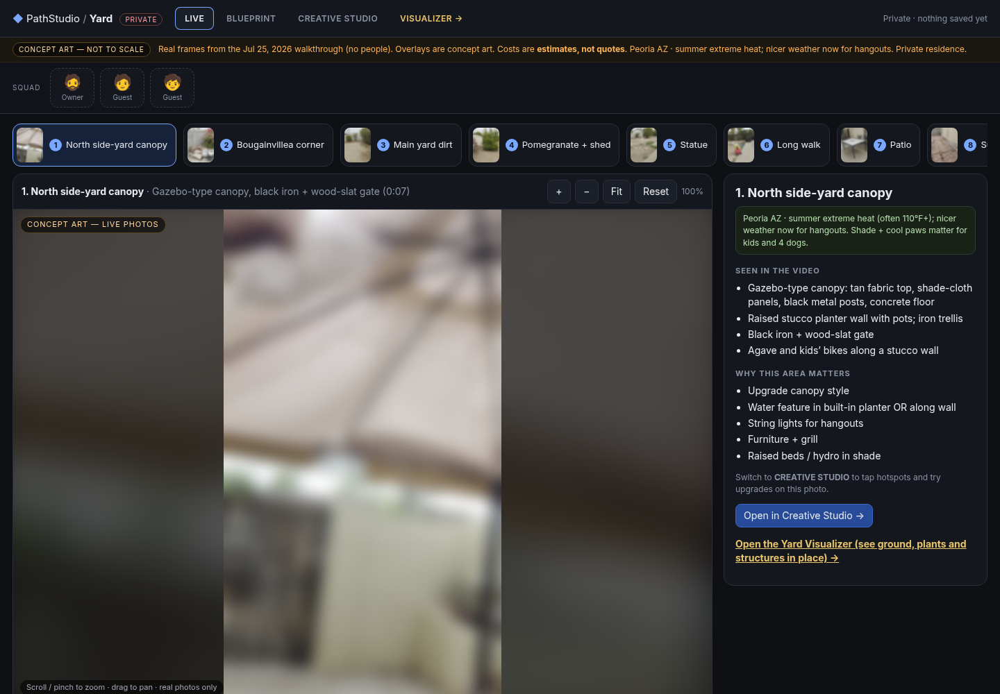

# Yard Visualizer

An offline planning studio for outdoor builds in the Arizona desert. Walk the yard area by area, compare ground covers, try structures and plants, and see planning-range costs before anything is built.

## Modes
- **LIVE**: walkthrough frames with pan and zoom, plus notes on each area.
- **BLUEPRINT**: top-down layout options A, B and C.
- **CREATIVE STUDIO**: tap hotspots to try upgrades (shade, water features, pergolas, raised beds).
- Ground-cover comparison tuned for desert heat, pets and water use.

Vanilla HTML, CSS and JavaScript. No build step, no network: open `index.html`, or `visualizer.html` to see ground, plants and structures in place.

> Property photos in this repo are deliberately blurred. Concept art is not to scale; costs are estimates, not quotes.

---
Built by **Samuel Rey Pineda**, founder of REY Process. Jesus is King.
